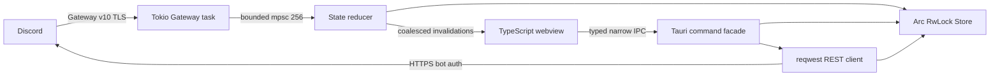

# Architectural blueprint

## Choose Tauri 2 for this product

Tauri runs a Rust native process and the platform webview: WebView2 on Windows and WKWebView on macOS. It avoids bundling an Electron Chromium runtime and suits advanced CSS themes, accessible text composition, and rapid UI iteration. This starter uses Vite and plain TypeScript to keep dependency and runtime overhead small. Tailwind can be added for static layout utilities; dynamic themes should still use semantic CSS variables. React is optional, not required by Tauri.

| Approach | Strengths | Costs for this client |
|---|---|---|
| Tauri + web UI (selected) | Mature CSS, typography, accessibility, native installers; Rust owns I/O | Webview processes still consume memory; rendering differs across OSes; IPC needs discipline |
| Iced | Pure Rust UI, explicit state/update model, strong control over rendering | Rich text/editor/accessibility and polished custom themes require more work; no CSS |
| Dioxus | Rust components, shared reactive UI; desktop commonly uses a webview | Still pays webview costs on desktop; Rust UI does not automatically mean lower memory |
| GPUI | GPU rendering and responsive native-style interfaces | More framework/platform-specific integration work; confirm current Windows/accessibility support before committing |

Use Iced if avoiding webviews outweighs advanced rich-text/theming needs. Consider GPUI after a platform prototype. Do not choose a framework from claimed memory numbers alone.

## Boundaries and data flow

`discord-core` has no GUI dependency. The native adapter owns lifecycle, credentials and command registration. Use a single runtime supplied by Tauri; do not construct another Tokio runtime inside a command. Async network tasks never block a UI thread. `Arc<RwLock<Store>>` protects short state mutations and clones; no lock is held across network I/O. A bounded `mpsc` queue applies backpressure and caps pending dispatch count. The UI receives invalidations at up to about 20 Hz rather than token-bearing Gateway payloads.

The current snapshot command clones the entire bounded message cache; this favors a reviewable starter over maximum throughput. Replace it with versioned per-channel snapshots and incremental patches before scaling to large guild counts. Guild and channel metadata are not bounded; implement subscription/eviction policy for large installations. Backpressure can eventually delay socket heartbeats under sustained overload: production should isolate control-frame handling from state dispatch and trigger a controlled reconnect/resume on overflow rather than silently drop data.

## Gateway lifecycle

1. Establish secure v10 JSON WebSocket; time out connection and HELLO waits.
2. Read `heartbeat_interval`; IDENTIFY with bot token and minimal requested intents, or RESUME using session ID and last dispatch sequence.
3. Jitter the first heartbeat and send the latest sequence. Require ACK before the next scheduled heartbeat. Reply to server heartbeat requests and WebSocket pings.
4. Dispatch events to the reducer. READY records session metadata; RESUMED preserves cache. A fresh READY clears stale state; GUILD_CREATE fills the initial guild/channel list.
5. Opcode 7, dead sockets, and missed ACKs cause exponential reconnect with jitter. Opcode 9 and close codes 4007/4009 can reset the session. Authentication/intents/sharding configuration errors are terminal and shown as status.

The implementation deliberately uses the known Discord Gateway host for token safety, accepts that exact resume URL, and otherwise falls back to the standard host. Production should validate Discord resume URLs with an explicit hostname policy, use `/gateway/bot` to inspect recommended shards and `session_start_limit`, coordinate IDENTIFY buckets across processes, respect reset windows, and support invalid-session timing and graceful cancellation. Current reconnect backoff is conservative for a single development bot, not a full session-limit scheduler. No compression or sharding yet.

Raw WebSockets demonstrate the protocol explicitly. For a production bot deployment, evaluate Serenity or Twilight's maintained Gateway/HTTP machinery rather than extending every edge case manually. Keep their models behind the core interface so the UI never depends on a transport crate.

## REST and cache

One reusable `reqwest::Client` pools connections with rustls and a request timeout. The auth header is marked sensitive; redirects are disabled. Channel IDs are restricted to decimal snowflakes before URL construction. Outgoing messages are limited to 1–2000 characters and disallow automatic mentions. A shared asynchronous request gate serializes requests, honors bounded 429 delays, and never automatically retries ambiguous POST network failures. Retrying an uncertain send could duplicate it; production needs nonce-based reconciliation and explicit retry UX.

Production rate limits require `X-RateLimit-Bucket` mapping, major-parameter keys, remaining/reset headers, global 429 coordination, total request deadlines, cancellation and fair queues. The simple gate is not sufficient for sustained high-volume traffic. Do not interpret every 403/404 as a network failure: Discord permissions and inaccessible channels are normal application errors.

Snowflakes remain strings end-to-end. Message storage is capped at 32 recent channels × 200 messages, with LRU channel eviction and ID deduplication for REST/Gateway overlap. Message create, partial content update and deletion are handled; guild and channel updates/removal are handled minimally. Ordering currently follows arrival/history insertion; concurrent history fetches and live dispatch can reorder messages. Before production, merge by snowflake/creation order, use request generations, and ignore stale fetch results. The channel list is not a full Discord permission engine; inaccessible history requests display errors.

Add SQLite (e.g. `sqlx`) for opt-in local persistence behind a separate repository trait. Batch transactions in a worker task, use WAL, bound retention and attachment bytes, migrate schemas explicitly, and clear private cached data on sign-out. Cache only necessary content, never credentials. Keep session state ephemeral unless encrypted and justified. Use Windows Credential Manager/macOS Keychain for credentials, not SQLite or plaintext configuration.

## Rendering and performance

The current renderer caps the selected timeline at 200 nodes, avoids Markdown/HTML injection, and does no idle polling. It replaces the bounded timeline on invalidation; implement keyed updates, virtual scrolling and pagination for production. Avoid serializing unused guild state or base64 attachments over IPC. Fetch media on demand, validate hosts and MIME types, bound decoded image size, and add a byte-bounded thumbnail cache. Decode/render away from input handling. Glass blur is opt-in because it increases GPU/compositing work.

Release builds use thin LTO, one codegen unit and stripped symbols. These optimize the shipped binary, not necessarily runtime memory. Measure the Rust process **and all child webview processes**. Proposed acceptance targets (not measured results): idle <1% CPU after settling, no periodic UI traffic, 60 fps scroll on target hardware, and memory materially below official Discord for the same guild/message/media workload. Compare cold startup, warm startup, idle, rapid event bursts and a 10,000-message scroll. Use Instruments/Allocations and Time Profiler on macOS; Windows Performance Recorder/Analyzer and WebView2 process metrics on Windows. Track p50/p95 input latency and memory plateaus after cache eviction.

## Themes and desktop security

`Theme { version, name, colors, glass }` is validated before setting six CSS custom properties. Imports are capped at 8 KB and colors must be six-digit hexadecimal. Unknown properties never become CSS. Built-in dark, light and neon themes use the same path. Theme preferences alone persist in localStorage. The blur effect is in-app translucency, not native macOS vibrancy or Windows Mica. Implement native effects behind platform adapters and retain a reduced-transparency option. Add a schema migration path and contrast/accessibility checks before distributing user themes.

Use native title bars, standard text controls, system font stacks, platform shortcuts, keyboard navigation and screen-reader audits. Pixel-identical CSS is not equivalent to native look and feel. App menus, Cmd/Ctrl shortcuts, OS theme observation, deep links and focus restoration belong in a platform adapter, not the transport.

The webview loads bundled local assets. CSP blocks external scripts/frames and network destinations except IPC; inline styles are needed for theme variables. Tauri capabilities keep the default main window core permissions; custom command validation remains necessary. No shell, filesystem, remote content, updater or arbitrary URL-opening plugin is enabled. Rust commands provide only snapshot/history/send. Treat even local UI inputs as untrusted. Production needs narrower channel-specific snapshots, redacted error reporting, dependency auditing, and signed updates. Tokens remain in backend memory and environment for this developer scaffold; disable core dumps and avoid logging auth payloads.

## Supported product scope

This architecture can power a bot-operated messaging console. It cannot turn a bot token into a user's private account view. A conventional Discord user client requires a supported agreement/API from Discord; OAuth2 authorization alone does not provide it. Voice/video is a separate project involving Discord voice Gateway, UDP/media, codecs, encryption, device routing and OS permission prompts. Evaluate current Discord protocol and encryption requirements before implementation; none are included here.

References: [Discord Gateway](https://discord.com/developers/docs/topics/gateway), [rate limits](https://discord.com/developers/docs/topics/rate-limits), [self-bot policy](https://support.discord.com/hc/en-us/articles/115002192352-Automated-User-Accounts-Self-Bots), [Tauri security](https://v2.tauri.app/security/).
